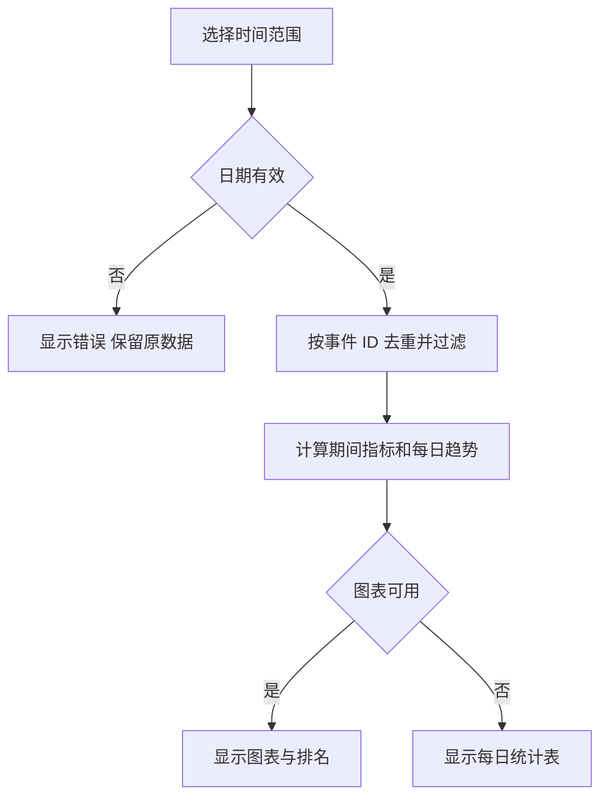
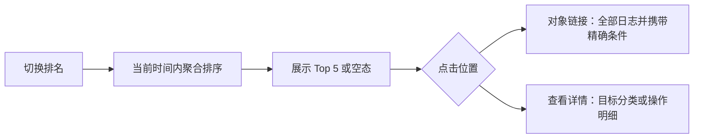
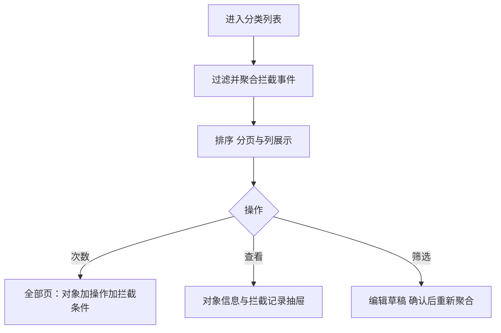
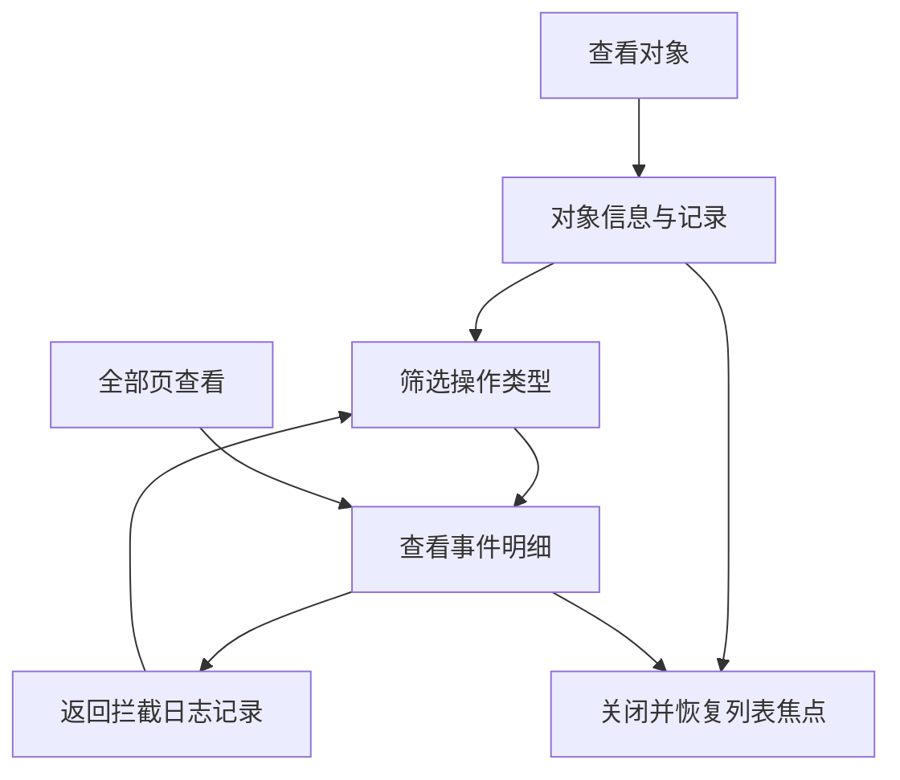
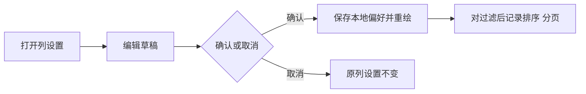
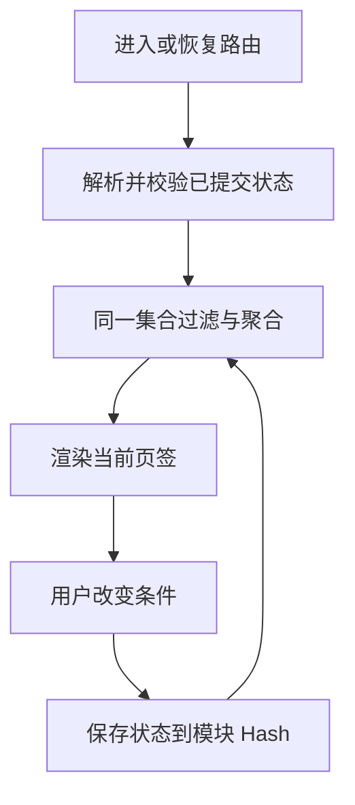

# 云登 PC 端 ·《访问拦截日志 PRD》

> 本文依照 `ProductAnalysis/通用模板/传统产品PRD模板.md` 编写。本模块覆盖审计看板、成员、平台账号、网页 URL 与全部日志。
> 文档状态：待评审。已交付交互原型不等于生产功能已通过评审或已实现客户端拦截。

## 一、版本修订记录

| 项目 | 内容 |
|---|---|
| 文档名称 | 云登 PC 端 · 访问拦截日志 PRD |
| 需求 ID | PRD-20260929-SECURITY-ACCESS-LOGS |
| 所属产品 / 模块 | 安全策略 / 访问拦截日志 |
| 需求类型 | 功能改造：单一访问日志扩展为五页签审计模块 |
| 优先级 | 原型范围 P0：五页签与查询追溯；生产排期由产品负责人确认 |
| 目标端 | 云登 PC 端，桌面及 768px 平板宽度适配 |
| 计划版本 / 上线时间 | 原型 V2.0；生产版本、上线时间列为 O-05 |
| 文档状态 | 待评审，数据口径与生产边界未全部确认 |
| 负责人 | 产品、设计、前端、客户端、后端、测试、数据、安全负责人实名待项目负责人分配，见 O-05 |
| 原型入口 | 根 `index.html?page=access-logs`，模块文件 `Prototype/访问日志.html` |
| 关联材料 | 用户本轮六张截图、四项指标说明、`design.md`、前版访问日志 PRD、传统产品 PRD 模板 |
| 最后更新 | 2026-09-29 |

### 1.1 修订记录

| 版本 | 日期 | 修改人 | 修订类型 | 变更摘要 | 影响范围 | 是否需重新评审 |
|---|---|---|---|---|---|---|
| V1.0 | 2026-08-27 | 项目原文档 | 新建 | 六列访问结果明细及成员、账号、结果筛选 | 访问日志 | 已有历史版本 |
| V2.0 | 2026-09-29 | Codex，按本轮用户需求整理 | 改造 | 五页签、四项指标、日趋势、双排名、对象聚合、列设置、下钻及事件详情 | 原型、查询模型、数据口径、接口建议及验收 | 是 |

#### 1.1.1 评审与决策记录

| 记录 | 日期 | 结论 | 关键决策 | 未决事项 |
|---|---|---|---|---|
| 用户输入 | 2026-09-29 | 已有明确需求 | 图 1、2 为看板；图 3 成员；图 4 账号；图 5 URL；图 6 全部；按 design 开发并按模板输出 PRD | 截图部分数字与文字定义存在歧义 |
| 本次实现选择 | 2026-09-29 | 原型暂行，非业务评审通过 | 沿用原入口；所有数值由统一事件集计算；列表结构化筛选采用规范抽屉 | O-01 至 O-05 |

#### 1.1.2 待确认事项

| 编号 | 事项 | 信息性质 | 影响 / 阻塞阶段 | 验证方式 / 备选方案 | Owner | 最晚确认时间 | 状态 |
|---|---|---|---|---|---|---|---|
| O-01 | 异常操作账号、成员数是否包含 URL 访问违规 | 截图操作数为 0、账号成员数为 1；用户文字说“违规操作”；口径询问尚未收到回复 | 数据权威口径；阻塞生产统计开发与评审通过，不阻塞明确标注假设的原型 | 暂按非 URL 操作去重；可改为所有拦截事件去重 | 产品 + 数据负责人 | 指标评审前 | Open |
| O-02 | 开发者模式是否具备阻断能力 | 新截图明确列“拦截开发者模式”；此前规划仅包含记录 | 客户端支持范围；阻塞该事件类型的生产接入 | 原型展示模拟拦截事件；客户端预研确认后决定是否改列名／事件类型 | 产品 + 客户端负责人 | 该事件类型开发前 | Open |
| O-03 | 全部页处理结果枚举、记录保留期限及日志查看权限 | 截图仅展示“拦截”，原型补充“记录／放行” | 权限、隐私、数据范围；阻塞生产接口评审 | 明确角色权限、保留期、查询审计；确定是否保留额外结果 | 产品 + 后端 + 安全负责人 | 接口定稿前 | Open |
| O-04 | 时间时区、超长范围、快照字段和多规则事件合并策略 | 原型采用团队 Asia/Shanghai 展示、最多 366 天、事件 ID 去重 | 数据一致性；阻塞生产聚合开发 | 与事件采集模型及数据仓库核对；原型规则见 BR-01 至 BR-10 | 产品 + 数据负责人 | 数据模型评审前 | Open |
| O-05 | 人员、工期、性能阈值、灰度比例与回滚指标 | 用户未提供 | 阻塞排期、性能验收与发布 | 评估访问量、数据量与客户端覆盖，再审批计划 | 项目负责人 + 研发 + 测试 | 排期／发布评审前 | Open |

未决事项不得被视为已获业务批准。原型中的补充设计用于本轮可操作演示，生产范围在对应事项关闭后进入开发。

### 1.2 甘特图

#### 1.2.1 项目计划

| 阶段 | 任务 / 交付物 | 日期 | 前置依赖 | Owner | 当前状态 / 完成门槛 |
|---|---|---|---|---|---|
| 需求 | 确认五页签、指标与字段口径 | 本轮材料日期 2026-09-29；评审日期待定 | 六张截图与指标说明 | 产品、数据 | 待评审；O-01/O-03/O-04 关闭 |
| 设计 | 单文件交互原型与 PRD | 2026-09-29 | 用户需求与 design | 产品、前端 | 原型及文档已编写；真实浏览器视觉验收待完成 |
| 技术 | 采集能力、查询聚合、权限方案 | 待排期 | 需求通过，O-02 关闭 | 客户端、后端 | 未开始；事件与接口契约确认 |
| 测试 | 功能、口径、权限、性能验收 | 待排期 | 可运行服务端版本 | 测试、数据 | 原型逻辑已检验；生产测试未开始 |
| 发布 | 内部验证、灰度、全量 | 待排期 | O-05 关闭与验收通过 | 项目、运维 | 未开始；可回滚 |
| 复盘 | 指标核对与查询使用效果 | 待排期 | 正式上线并达到观察周期 | 产品、数据 | 未开始；有可追溯数据 |

#### 1.2.2 甘特图说明

未提供正式开始日期、工期与资源，故不使用模板中的示例日历填充虚假甘特图。O-05 关闭后依据上表生成甘特图；当前依赖为：需求确认 → 数据／客户端技术评审 → 生产开发 → 测试 → 灰度 → 全量 → 复盘。

#### 1.2.3 发布门禁与回滚

| 阶段 | 进入条件 | 数据与判定 | 暂停／回滚条件 | Owner |
|---|---|---|---|---|
| 内部验证 | 指标与事件模型定稿，隔离测试团队 | 固定事件集逐条核对指标、趋势、排行与明细 | 任一同口径结果不一致或跨团队可见即停止 | 数据、测试 |
| 灰度 | 功能、权限与性能验收通过 | 窗口、样本、延迟及成功率阈值由 O-05 定稿 | 超阈值或日志泄露时停止放量；保留日志采集，回退查询界面／聚合版本 | 运维、安全 |
| 全量 | 灰度达到已批准的窗口与样本量 | 全量检查使用同一指标口径 | 回退 UI 不删除历史事件；新旧查询口径需可追溯 | 项目负责人 |

## 二、产品概述

### 2.1 产品介绍

#### 2.1.1 产品背景

现有原型仅包含逐条访问日志，无法直接查看成员、账号和 URL 的违规分布。用户提供新的五页签页面，要求从汇总看板查看拦截情况，再按对象查询、定位事件。

| 编号 | 判断 | 定性 | 证据 | 对需求的影响 |
|---|---|---|---|---|
| BG-01 | 新模块包含五个页签 | 已核实事实 | 本轮图 1–6 | 五个视图必须可切换 |
| BG-02 | 需要四项指标及其问号说明 | 已核实事实 | 用户文字与图 1、2 | 帮助内容可悬停、聚焦、点击查看 |
| BG-03 | 图中列表有列设置、排序、数字链接与查看 | 已核实事实 | 图 3–6 | 补足实际交互和追溯路径 |
| BG-04 | 聚合视图能减少人工日志检索时间 | 待验证假设 | 当前任务推导，无用户研究数据 | 上线后用查询成功率和耗时验证 |

问题陈述：安全管理者需要知道何时、哪些对象、哪些操作被拦截；现有逐条查询不能直接提供分布概览。本需求通过同源聚合与下钻减少视图之间的人工比对。

#### 2.1.2 产品机遇

| 类型 | 机遇与证据 | 置信度 / 验证 |
|---|---|---|
| 用户 | 用户直接要求按成员、账号、URL 查看 | 高，来源为本轮输入 |
| 技术 | 复用同一事件集生成多个视图 | 原型已验证；生产事件完整性待评估 |
| 商业／市场 | 未提供收费、收入、竞争或市场证据 | 不作结论 |

| 方案 | 收益 | 成本／限制 | 本次结论 |
|---|---|---|---|
| 五页签同源查询 | 汇总到明细可核对，满足截图 | 需明确聚合口径与客户端事件能力 | 本轮采用 |
| 保留逐条列表 | 改动小 | 无法满足看板与对象统计 | 不满足本轮需求 |
| 人工导出汇总 | 可作为生产能力缺失时的流程替代 | 本轮无导出授权且难以保持统计口径一致 | 不实现 |

#### 2.1.3 产品价值

帮助安全管理者从汇总数据定位具体事件，理解操作、对象和命中规则。不能以“拦截次数增加”推断安全风险降低。

| 指标 ID | 目标与计算方式 | 基线 | 目标值 | 周期 / 来源 | Owner |
|---|---|---|---|---|---|
| Q-01 | 同过滤条件下聚合与明细核对一致的测试项数／全部核对项 | 原型固定数据可复算 | 原型验收全部一致；生产阈值待定 | 每次版本；测试数据 | 数据、测试 |
| Q-02 | 用户从汇总到目标事件成功次数／有效查询任务数 | 待测量 | 待试点定义 | 试点观察期；匿名操作埋点 | 产品 |
| Q-03 | 查询响应时间与错误率 | 待测量 | O-05 定义 | 生产请求日志 | 研发、运维 |

本期范围：五页签、日期、列表搜索与筛选、指标说明、趋势、排名、列设置、排序、分页、统计下钻、对象详情与事件详情。非目标：客户端实际拦截实现、修改／删除日志、导出、风险评分模型、截图录像或页面内容采集。

### 2.2 产品用户

#### 2.2.1 用户类型

| 用户 | 任务 | 权限方向 | 频率与成功标准 |
|---|---|---|---|
| 安全管理员／团队负责人 | 审视风险分布并定位对象 | 团队授权范围内查询 | 频率待测；汇总可追溯 |
| 审计人员 | 查询事件时间、操作、规则和结果 | 可单独授予只读日志权限 | 按调查触发；明细解释充分 |
| 普通成员 | 是否允许查询本人记录待定 | 不默认开放所有团队记录 | O-03 定稿 |
| 外部访客 | 无业务场景 | 不开放 | 不适用 |

#### 2.2.2 地域分布

用户地区、人数、语言占比未提供。原型使用简体中文、日期 `YYYY-MM-DD`、时间精确到秒，以 Asia/Shanghai 作为演示时区，不包含货币。正式产品应采用已定团队时区，跨时区聚合见 O-04。

### 2.3 用户需求

#### 2.3.1 需求来源与证据

六张附件是本轮唯一页面结构来源；四项指标文字是指标需求来源。`design.md` 定义颜色、字体、表格、抽屉与分页。无访谈样本、市场调研或线上行为基线，不虚构对应材料。

#### 2.3.2 需求清单与优先级

| 需求 ID | 用户需求 | 优先级 | 对应功能 | 证据 |
|---|---|---|---|---|
| UR-01 | 了解指定时期 URL 与操作拦截情况 | P0 | F-01 | 图 1、2 |
| UR-02 | 比较访问／操作和账号／成员的拦截排名 | P0 | F-02 | 图 1、2 |
| UR-03 | 按成员、账号、URL 查询拦截分布 | P0 | F-03 | 图 3–5 |
| UR-04 | 检索与查看逐条事件 | P0 | F-04、F-05 | 图 6 的查看入口 |
| UR-05 | 自定义显示列并排序、翻页 | P1 | F-06 | 图 3–5 设置／排序；分页为可用性补充 |
| UR-06 | 时间和钻取条件可恢复 | P1 | F-07 | 本次补充设计 |

#### 2.3.3 关键用户旅程

进入审计看板 → 选择时间 → 查看指标与排名 → 点击排名对象或“查看详情” → 进入对应列表 → 调整筛选／排序 → 点击次数下钻到全部页，或点击“查看”打开对象详情 → 查看事件明细 → 返回原查询上下文。

### 2.4 功能清单

| ID | 功能 | 输入 | 输出 |
|---|---|---|---|
| F-01 | 时间、指标和趋势 | 时间范围、唯一事件集 | 四项 KPI、五张同源趋势图 |
| F-02 | 排名 | 被拦截事件、两组独立排名 Tab | Top 5 与查询入口 |
| F-03 | 三类聚合列表 | 时间、对象、关键词 | 成员／账号／URL 行及六类拦截计数 |
| F-04 | 全部日志 | 时间、成员、账号、动作、结果、关键词、精确 URL | 事件列表 |
| F-05 | 对象及事件详情 | 对象 ID、事件 ID、当前查询上下文 | 800px 业务详情抽屉 |
| F-06 | 列设置、排序、分页 | 当前页签及用户选择 | 个性化展示，不改变统计集合 |
| F-07 | 查询导航与恢复 | URL Hash、浏览器前进后退、模块状态 | 保留页签与查询状态 |

### 2.5 产品架构

#### 2.5.1 功能架构

```text
访问拦截日志
├─ 审计看板：四项指标、日趋势、访问/操作排名、账号/成员排名
├─ 成员：授权账号、六类拦截计数、列设置、查看
├─ 平台账号：授权成员、六类拦截计数、列设置、查看
├─ 网页 URL：平台账号数、六类拦截计数、列设置、查看
└─ 全部：事件列表、结果/操作筛选、事件查看
共享：时间范围、列表搜索、筛选抽屉、分页、详情、路由恢复
```

#### 2.5.2 信息架构与入口

系统框架 → 安全策略 → 访问拦截日志。沿用 page key `access-logs` 及原文件名，避免旧链接失效。默认打开审计看板。Hash 中保存 `tab/from/to/preset/member/account/url/action/result/keyword/sort/direction/p/size/actionRank/entityRank`，公共层将其映射为宿主 `moduleHash`。

#### 2.5.3 系统与数据边界

SystemFrame 管理导航、路由与公共分页资源。页面负责模拟事件查询、聚合、图表和业务抽屉。当前无真实网络接口、登录权限或客户端动作执行。后端正式接入后负责鉴权、脱敏、事件去重、时区、聚合、分页及详情权限。

### 2.6 专有名词解释

| 名词 | 权威定义 |
|---|---|
| 拦截事件 | `result=block`，表示一次动作被实际阻止的事件；本原型仅模拟 |
| URL 访问 | `action=url`；计次数，不按不同网址去重 |
| 操作事件 | `upload/download/copy/print/devtools`；不包含 URL 访问 |
| 异常操作账号／成员 | 暂以操作拦截事件中的不同账号 ID／成员 ID 定义，O-01 未决 |
| 风控排名 | 按拦截次数排序；不是风险评分、损失评估或恶意判断 |
| 授权账号／成员 | 授权关系，不等于在选定时期发生事件的账号／成员集合 |
| URL 平台账号数 | 当前过滤范围下，该 URL 拦截事件涉及的平台账号 ID 去重数 |

## 三、功能说明

### 3.1 功能详细说明

#### 3.1.1 F-01 审计看板与时间筛选

##### a）原型

参考图 1、2。左侧 2×2 指标卡，右侧日趋势；下方双排名区。桌面两列、窄于 1150px 时趋势和排名纵向排列；KPI 卡保持两列。图中装饰曲线替换为真实模拟数据趋势，颜色仅取 design 的 primary、success、danger、warning。

时间工具支持今天、近 7 天、近 30 天、自定义。演示基准日固定为 2026-09-29，并在页面注明模拟数据；“近 7 天”为 09-23 至 09-29。自定义编辑后点击“应用”，有效后统一刷新全部视图。

##### b）功能说明

| 指标 ID | 标题 | 问号说明与计算 | 去重 |
|---|---|---|---|
| K-01 | 拦截 URL 访问数 | 统计进行违规访问 URL 总数；`action=url AND result=block` 的事件次数 | 先按事件 ID 去重；相同 URL 多次访问累计 |
| K-02 | 拦截操作数 | 统计进行了违规操作总数；`action!=url AND result=block` 的事件次数 | 事件 ID |
| K-03 | 拦截异常操作账号数 | 统计进行了违规操作的账号总数；K-02 事件中的账号数 | 平台账号 ID；暂行口径 O-01 |
| K-04 | 拦截异常操作成员数 | 统计进行了违规操作的成员总数；K-02 事件中的成员数 | 成员 ID；暂行口径 O-01 |

每日小图按当日同口径统计；K-03、K-04 的期间总数不可用每日去重数直接相加。主趋势只展示 K-01、K-02。无事件显示 0 与空排名，不造曲线；Chart.js 加载失败时显示按日统计表，仍能阅读真实数值。问号支持 hover、focus、click，Escape 关闭。

| 规则 | 内容 | 验收 |
|---|---|---|
| BR-01 | 所有统计先按事件 ID 去重，再过滤时间和结果 | AC-01 |
| BR-02 | 时间范围包含开始、结束日完整自然日；每个缺失日期补 0 | AC-02 |
| BR-03 | 日期必须完整有效且开始不晚于结束；原型单次最多 366 天 | AC-03 |
| BR-04 | Dashboard 仅使用时间范围，不继承其他页签临时搜索／对象筛选 | AC-04 |

读操作无业务写入，无幂等提交问题。日期错误保留输入和上一次有效数据；加载失败不得把 0 当作正常结果。生产查询加载／错误／无权限遵循 G-01 至 G-06。

##### c）流程图



#### 3.1.2 F-02 访问、操作、账号与成员排名

##### a）原型

左区为“拦截访问排名／拦截操作排名”；右区为“平台账号风控排名／成员操作风控排名”，独立切换。每区右上保留“查看详情”。采用相同数据表格规范，无数据时展示“暂无拦截记录”。

##### b）功能说明

| 分组 | 表格字段 | 统计与排序 | 点击对象／查看详情 |
|---|---|---|---|
| 访问排名 | 排名、网页地址、拦截次数 | URL 访问拦截按 URL 分组，次数降序，最多 5 行 | URL 点击进入全部并带精确 URL、拦截条件；更多进入网页 URL 页 |
| 操作排名 | 排名、操作内容、拦截次数 | 非 URL 操作拦截按动作分组，次数降序，最多 5 行 | 动作点击进入全部并带动作、拦截条件；更多带非 URL 操作条件 |
| 账号排名 | 排名、账号名称、所属平台、拦截次数 | 全部拦截事件按账号分组，次数降序 | 对象点击带账号及拦截条件；更多进入平台账号页 |
| 成员排名 | 排名、成员、角色、拦截次数 | 全部拦截事件按成员分组，次数降序 | 对象点击带成员及拦截条件；更多进入成员页 |

BR-05：同次数按对象 ID／URL／操作 key 升序稳定排列。右侧排名包含 URL 和非 URL 拦截，因此不等同于 K-03/K-04 的暂行去重口径。每个钻取保留时间范围，清除无关条件。

此处对“成员操作风控排名”采用全类型拦截次数，与截图仅 URL 拦截也出现成员排名的例子保持一致；生产评审需同时核对 O-01，避免把指标卡和排名误解为同一个分母。

##### c）流程图



#### 3.1.3 F-03 成员、平台账号、网页 URL

##### a）原型

对应图 3–5。时间工具栏共用；搜索在右侧；成员、账号条件收纳到 480px 筛选抽屉。URL 页不显示成员筛选。列表右侧提供列设置；表格允许横向滚动，不挤压字段。

##### b）功能说明

| 页签 | 主列 | 第二列 | 六类统计列 | 末列 |
|---|---|---|---|---|
| 成员 | 操作成员 | 授权账号 | 拦截网页访问／文件上传／文件下载／复制／打印／开发者模式 | 查看 |
| 平台账号 | 平台账号 | 授权成员 | 同上，引用字段 C-01 至 C-06 | 查看 |
| 网页 URL | 网页 URL | 平台账号去重数 | 同上，引用字段 C-01 至 C-06 | 查看 |

| 字段 ID | key | 内容 | 数据来源与展示 |
|---|---|---|---|
| C-01 | url | 网页访问拦截次数 | 当前过滤事件集中 `action=url AND result=block` |
| C-02 | upload | 文件上传拦截次数 | `action=upload AND result=block` |
| C-03 | download | 文件下载拦截次数 | `action=download AND result=block` |
| C-04 | copy | 复制拦截次数 | `action=copy AND result=block` |
| C-05 | print | 打印拦截次数 | `action=print AND result=block` |
| C-06 | devtools | 开发者模式拦截次数 | `action=devtools AND result=block`；真实能力见 O-02 |

BR-06：先按查询条件过滤事件，再按成员／账号／URL 聚合；仅出现有拦截事件的对象。六类列支持数值排序；默认按总拦截次数降序并以 ID 稳定排序。列帮助明确计数含义。

点击次数（包括 0）进入全部页，带当前对象、操作类型、拦截结果和时间；0 次显示正常空态。点击对象名称或“查看”打开对象详情。授权关系来自对象元数据；不得把“出现过事件的成员”误写为全部授权成员。超长名称、授权关系及 URL 省略并通过 title 显示完整脱敏值。

##### c）流程图



#### 3.1.4 F-04 全部日志

##### a）原型

对应图 6。成员、账号、结果与操作内容均置于筛选抽屉，替代截图的横向展开区。保留时间条件、查询计数、列设置与分页。

##### b）功能说明

| 列 | key | 格式 / 展示 |
|---|---|---|
| 操作成员 | member | 事件关联的成员名称 |
| 平台账号 | account | 脱敏账号名称 |
| 页面 URL | url | 等宽、截断、title 完整脱敏值；不自动打开外部网页 |
| 操作内容 | action | C-01 至 C-06 的动作名称 |
| 操作时间 | time | `YYYY-MM-DD HH:mm:ss`，等宽；默认降序，可切换升序 |
| 拦截规则 | rule | 命中规则名称；非拦截事件表示对应判定规则 |
| 处理结果 | result | 拦截 danger；记录 info；放行 success；纯语义色文字 |
| 操作 | view | 查看，进入事件详情 |

BR-07：全部页包含拦截、记录、放行三类原型事件；看板与聚合计数仅取拦截。后两种结果是本次模拟补充，生产枚举见 O-03。搜索匹配成员、账号、URL、操作名称、规则与判定原因；中文逗号拆词，词间并集，搜索与结构化筛选交集。

BR-08：所有日志只读，不提供删除、修改或拦截重试操作。重复点击查看只展示已有事件，不新增任何日志。实体与规则名称生产应来自事件快照，原型使用稳定内联关联对象。

##### c）流程图


#### 3.1.5 F-05 对象详情与事件明细

##### a）原型

用户未提供详情截图。本次补充采用 design §5.7 的 800px 业务抽屉、56px 标题栏、可滚动正文、信息两列布局；窄于 768px 改一列。抽屉限于模块 iframe，非全局遮罩。

##### b）功能说明

对象详情上部为成员／账号／URL 信息及统计时间，下部为当前查询上下文内的拦截记录。支持按操作内容进一步过滤；显示操作时间、成员／账号、操作内容和查看。记录多时正文滚动，不截断前 N 条。

事件详情展示：日志编号、操作成员、角色、平台账号、所属平台、脱敏账号标识、环境编号、网页 URL、动作、操作时间、处理结果、命中规则、规则编号、规则版本、判定原因。

从对象详情进入事件明细，原抽屉内容切换，提供“返回拦截日志记录”，保留对象内动作筛选；不叠加第二层抽屉。从全部页直接查看时不显示该返回按钮。关闭、遮罩、Escape 均返回原触发点。不存在记录显示可恢复说明，不展示空白详情；生产权限变更见 G-04。

##### c）流程图



#### 3.1.6 F-06 列设置、排序与分页

##### a）原型

列设置使用业务设置抽屉，勾选列名称；对象列与操作列固定不可隐藏，提供恢复默认、取消、确定。每个列表页签独立存储显示列。分页复用公共导航注入的 `YDPager`，表格末行到分页顶部保留 20px。

##### b）功能说明

| 操作 | 规则 | 成功 / 取消 / 失败 |
|---|---|---|
| 调整列 | 草稿确认后生效；按页签保存隐藏列 key | 取消不更改；本地存储不可用则当前会话仍生效 |
| 恢复默认 | 只将当前草稿全部勾选 | 仍需确认才应用 |
| 排序 | 统计列按数值；全部页时间按字符串时间；首次点击降序，再点击升序 | 回第一页；表头同步 aria-sort 与双三角高亮 |
| 分页 | 默认 10 条，可选 20、50；作用于完整过滤结果 | 换页不清查询；筛选和排序回第一页 |
| 跳页 | 只接受有效正整数页码，越界显示错误 | 不跳转、不丢查询；成功后跳页输入复位为 1 |

列偏好为本机展示状态，不写业务实体，不产生修改日志。原型本地键 `yunlogin.access-log-columns.v1`；偏好只保存列 key，不保存敏感数据。

##### c）流程图



#### 3.1.7 F-07 状态恢复与通用查询

##### a）原型

导航仍为单文件五视图，无第二套 App Shell。查询上下文显示在列表上方，展示生效的对象／结果／操作条件，支持清除。顶部时间范围跨页签保持。

##### b）功能说明

BR-09：手动切换顶级 Tab 清除该次对象、搜索和操作条件，保留时间；通过下钻进入时显式传入条件。时间改变保留当前列表对象条件并回第一页。浏览器前进、后退、刷新恢复已提交状态，列设置由本地偏好恢复。抽屉临时草稿不写 URL。

BR-10：非法 Hash 页签回审计看板；无效日期回演示近 7 天；未知实体／枚举不参与过滤；无效页容量回 10，越界页码取有效末页。URL 中不存密码或账号凭据。生产应评估敏感查询条件能否持久化到浏览器历史，见 O-03。

查询动作无数据库写入。前端新请求取代旧请求时，生产以请求序号或取消机制阻止旧响应覆盖新结果；原型同步内存查询，不存在网络竞态。

##### c）流程图



### 3.2 全局说明

#### 3.2.1 权限说明

正式服务端须校验团队归属与日志查看权限，聚合与明细采用同一可见范围；不可只在前端过滤。汇总权限不自动授予明细权限。普通成员、审计角色与管理员权限矩阵待 O-03 定稿。当前原型使用模拟管理员视角，不宣称实现真实授权。

#### 3.2.2 授权说明

账号授权成员、成员授权账号属于只读信息；页面不改变访问策略、审批授权或账号权限。查看日志不会触发被记录的 URL 访问或危险操作。账号和成员退出团队后，正式历史事件按快照规则展示，不因实体删除丢失记录解释。

#### 3.2.3 异常说明

| 公共规则 | 状态 | 表现与恢复 | 原型／生产边界 |
|---|---|---|---|
| G-01 | 加载中 | 生产请求展示加载态，保留查询条件；旧数据标明更新中 | 原型为同步内存计算，无伪造等待 |
| G-02 | 无数据／筛选无结果 | 指标为 0，排名空态，列表“暂无符合条件的日志”；可重置筛选 | 已实现；重置不改变时间 |
| G-03 | 查询失败 | 显示“日志加载失败，请重试”，不得用空数据覆盖；保留条件 | 生产接口要求，原型无远程接口 |
| G-04 | 无权限／权限撤销 | 停止返回数据，详情关闭或显示无权限状态；服务端拒绝 | 生产门禁，原型不伪造鉴权 |
| G-05 | 第三方图表不可用 | 按日数据表降级，列表与统计仍可用 | 已实现 |
| G-06 | 数据不存在／部分信息缺失 | 详情提供关闭恢复；生产快照缺失显示“已删除对象／未知”，不猜测身份 | 原型有不存在提示；历史缺失规则待后端 |
| G-07 | 重复提交／并发 | 日期与筛选只替换查询状态，日志不增加；生产仅最新请求有效 | 原型同步完成；无业务写入幂等键 |
| G-08 | 本地偏好损坏 | 忽略异常格式，使用默认列；内存操作仍可用 | 已实现 |

**确认弹窗：**无删除、覆盖、支付等危险写操作，不设置二次确认。筛选／列设置的“确认”仅提交本地展示状态。

#### 3.2.4 键盘说明

Tab 可遍历控件；顶层及排名 Tab 支持左右方向键、Home、End；Enter 提交搜索、日期、筛选或跳页。抽屉开启后背景 inert、锁定滚动，Tab 限于抽屉；Escape 关闭且恢复触发控件焦点。帮助问号可聚焦并读出说明。表格横向区域可聚焦。

#### 3.2.5 字段规则

| 字段 | 类型 / 默认 | 读写 | 校验与脱敏 |
|---|---|---|---|
| event.id | 唯一字符串 | 只读 | 聚合去重主键，禁止用时间+姓名替代 |
| event.time | 秒级时间；正式接口带时区 | 只读 | 事件发生时间，原型显示团队时区 |
| member/account | 实体 ID，关联快照名称 | 只读 | 同名对象不合并；账号凭据不返回 |
| event.url | 已脱敏 URL | 只读 | 移除凭据、fragment 与敏感 query；本原型均无敏感 query |
| action | 六类操作枚举 | 只读；查询可选 | 无法支持的客户端动作不能伪造拦截成功 |
| result | block/record/allow | 只读；查询可选 | 后两项为原型暂行枚举，见 O-03 |
| ruleId/ruleVersion/reason | 规则快照 | 只读 | 详情解释事件发生时的结果；不重新执行当前策略 |
| from/to | 日期，默认近 7 天 | 查询可写 | 日期完整、顺序正确、跨度限制 |
| keyword | 字符串，默认空 | 查询可写 | trim、大小写不敏感、中文逗号拆词；渲染 HTML 转义 |
| page/pageSize | 正整数，默认 1/10 | 查询可写 | 容量只允许 10/20/50；无数据按 1 页处理 |

**接口与契约建议（均未连接）：**

| 场景 | 建议接口 | 请求 | 响应 | 权限 / 失败 |
|---|---|---|---|---|
| 看板 | GET `/api/security/access-logs/dashboard` | from、to、timezone | 指标、每日序列、两组排名、统计版本 | 统一日志查看权限；401/403/5xx |
| 聚合 | GET `/api/security/access-logs/summary` | groupBy、日期、对象、关键词、排序、分页 | rows、total、范围与版本 | 同一团队过滤；无数据为正常空数组 |
| 全部 | GET `/api/security/access-logs` | 日期、动作、结果、对象、URL、关键词、分页 | events、total | 禁止越权查询；校验所有枚举 |
| 详情 | GET `/api/security/access-logs/{id}` | 事件 ID | 脱敏事件快照与判定信息 | 详情独立权限；404/403 |

数据字典及接口仅为方案建议，后端命名和分页协议待技术评审。所有接口为只读，可有限重试；实际重试次数、超时由 O-05 定稿。

**正式文案：**日期错误使用“开始日期不能晚于结束日期”；范围错误使用“单次查询最多支持 366 天，请缩小日期范围”；列表空态使用“暂无符合条件的日志”；排名空态使用“暂无拦截记录”；组件降级使用“图表组件未加载，以下为按日统计”。

**验收标准：**

| ID | Given | When | Then | 优先级 / 方法 |
|---|---|---|---|---|
| AC-01 | 固定近 7 天模拟数据 | 查看审计看板 | K-01=11、K-02=57、K-03=12、K-04=10；按 O-01 暂行口径 | P0，独立事件复算 |
| AC-02 | 日期中存在无事件日 | 查看趋势 | 缺失日补 0；趋势总次数等于对应 KPI | P0，数据核对 |
| AC-03 | 开始大于结束或范围超限 | 应用 | 明确错误；旧有效结果不变 | P0，交互 |
| AC-04 | 其他页签有对象筛选 | 手动返回看板 | 看板只受时间影响，不残留对象筛选 | P0，交互 |
| AC-05 | 成员／账号／URL 汇总行 | 点击任一次数 | 全部页携带对象、动作、拦截条件；明细条数等于该数 | P0，数据核对 |
| AC-06 | 筛选草稿已更改 | 取消／Escape／遮罩 | 结果与角标保持提交前状态 | P0，交互 |
| AC-07 | 有多个同值排序行 | 来回排序与分页 | 数值排序正确，同值次序稳定，过滤条件不丢失 | P1，逻辑 |
| AC-08 | 列设置已隐藏复制列 | 确认再刷新当前 Tab | 复制列保持隐藏，其他 Tab 不受影响；恢复默认后可恢复 | P1，逻辑 |
| AC-09 | 对象详情有记录 | 查看事件再返回 | 对象和详情动作筛选保留；关闭恢复焦点 | P1，交互 |
| AC-10 | 有 Hash 查询状态 | 刷新或前进后退 | Tab、日期、筛选、排序与分页恢复 | P1，路由 |
| AC-11 | 无匹配事件 | 看板及列表切换 | 0 值、空态正确，无除零或图表异常 | P0，逻辑 |
| AC-12 | Chart.js 不可用 | 打开看板 | 数值可读，日统计表降级，其他查询可用 | P1，依赖失败 |
| AC-13 | 768px / 1440px | 打开各视图与抽屉 | 页面不横向溢出，表格内部可滚动，抽屉不裁切 | P1，浏览器视觉待验收 |
| AC-14 | 重复事件 ID 被重复上报 | 计算各视图 | 唯一 ID 只统计一次 | P0，数据核对 |
| AC-15 | 正式服务端用户无对象权限 | 查询聚合及详情 | 拒绝并记录安全审计，无跨团队泄露 | P0，生产接口验收 |

## 四、非功能性需求

### 4.1 性能需求

原型使用 180 条内联事件，覆盖 15 天、10 名成员、12 个账号、12 个 URL、六类操作及三类处理结果；主要列表在默认时间内均可演示多行与分页。最多 366 天限制用于约束演示图表规模，不代表生产保留期限。生产聚合规模、P95 响应阈值、最大并发与查询超时均待 O-05，不能以本地查询结果替代压测。

### 4.2 监控需求

#### 4.2.1 业务与产品监控

| 事件 ID | 触发 | 属性 | 去重 | 禁止采集 |
|---|---|---|---|---|
| query_logs | 查询成功完成 | tab、过滤类型数量、耗时、结果规模区间 | requestId | 原始关键词、完整 URL、账号凭据 |
| drill_logs | 点击汇总进入明细 | 来源视图、分组类型、动作类型 | 一次用户动作 | 个人身份明文与敏感 URL |
| view_log_detail | 查看事件详情成功 | 权限上下文、脱敏对象标识、事件 ID | requestId | 页面正文、输入值、密码、Token |

以上为生产埋点建议，原型不向外部发送埋点。查看敏感日志的审计记录应与查询事件独立管理，不能回灌成为本模块被拦截事件。

#### 4.2.2 技术与质量监控

观察查询错误率、响应耗时、事件重复率、迟到数据比例、聚合明细不一致、图表依赖失败、权限拒绝率。阈值与通知人员待 O-05；数据不完整时不自动解释为零风险。

### 4.3 兼容性需求

原型支持无构建的 HTML 与 `file://` 入口适配；直接打开模块由公共导航回根框架。保留唯一 App Shell，不产生嵌套系统框架。桌面 ≥1280px、平板 768px；CDN 不可用时图表提供数据降级。真实浏览器、客户端版本矩阵与视觉验收仍需记录验证结果，不能以 DOM 逻辑测试代替。

### 4.4 技术组件需求

语义 HTML5、原生 JavaScript、Tailwind CDN、Lucide CDN、Chart.js CDN。颜色、字号、圆角、间距引用 design.md；数字、编号、日期和 URL 使用 JetBrains Mono。公共导航 CSS／JS 在 head 按顺序同版本引用；分页复用公共层注入的 YDPager。无 Vue、React、jQuery 或新增第三方业务依赖。

### 4.5 安全性需求

不采集正文、输入值、密码、Cookie、Token、截图、录像或文件原文。全部输出字符串转义，URL 作为文本而非可执行链接。统计次数与真实拦截执行状态一致才允许计入，不把“配置了限制”当作“发生了拦截”。生产聚合和详情必须统一权限范围与数据版本。

#### 4.5.1 安全验收用例

| 用例 | 检查 | 预期 |
|---|---|---|
| SEC-01 | URL、名称中出现 HTML 标签文本 | 只显示文本，不执行脚本 |
| SEC-02 | 篡改查询中的成员、账号或事件 ID | 原型忽略无效查询实体；生产服务端重新鉴权 |
| SEC-03 | 已删除成员／账号历史事件 | 正式系统保留快照，不将同名新对象混入统计 |
| SEC-04 | 重复 ID、迟到数据 | 去重，汇总与明细同版本；迟到数据刷新策略需定稿 |
| SEC-05 | 关闭详情或切换列表 | 不发起策略修改、访问请求或账号授权操作 |

## 附录：交付前检查清单

- [x] 五个页签及对应字段覆盖图 1–6。
- [x] 四项指标与排名、明细使用同一事件集合。
- [x] 180 条模拟数据覆盖多成员、账号、URL、操作与处理结果。
- [x] 日期、筛选、排序、列设置、分页、详情与状态恢复通过 DOM 逻辑检查。
- [x] 图表不可用时存在数据降级路径。
- [x] PRD 按模板保留版本、产品、功能、非功能和验收结构，未知内容归入待确认。
- [ ] O-01 至 O-05 完成评审；当前文档仍为待评审。
- [ ] 真实浏览器 768px／桌面视觉、CDN 图表渲染及实际 SystemFrame 前进后退验收。
- [ ] 生产接口、鉴权、客户端事件及灰度门禁验收。
